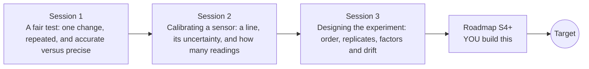

# openexperiment

[](https://github.com/KrunalPanchal1995/openexperiment/actions/workflows/ci.yml)   [](https://colab.research.google.com/github/KrunalPanchal1995/openexperiment/blob/main/sessions/session-01/lesson.ipynb) [](https://krunalpanchal1995.github.io/openexperiment/)

**Design a fair experiment and calibrate a sensor, in three sessions.**

openexperiment teaches how to test one thing fairly, calibrate a sensor with a line, and design runs that drift cannot fool, using only Python and a browser.

- **Start from zero.** Session 1 needs only school arithmetic; a fair test and accurate versus precise are explained from scratch.
- **See it move.** Every session ships a slider app that runs in the browser, with labelled graphs.
- **Know you got it right.** Each session ends with a checkpoint that prints PASS or FAIL; every claim is checked against a simulated truth.
- **Build the missing half.** The repo stops at Session 3 on purpose; the roadmap shows the path to the Target.

[Target](#the-target) · [Who is this for](#who-is-this-for) · [Quick start](#quick-start) · [Sessions](#sessions) · [Roadmap](#roadmap) · [Contribute](#contribute) · [Explainer PDF](docs/explainer.pdf)

> **This repo is incomplete on purpose.** Sessions 1 to 3 are here and fully working. The finished Target below is a preview of what the community can build next. We show you the path, not the code. Sessions 4 and up are yours.

## The Target

Four panels run together. A calibration line tightens as readings arrive, its 95 percent band shrinking. Two target boards show the key lesson of measurement: one sensor is precise but biased, so averaging never moves it to the centre; the other is unbiased but noisy, so averaging does. In the last panel a drifting sensor tests two treatments that do nothing: with all A runs first, the experiment claims a large effect, while shuffling the order gives about zero on average. Your goal over the coming sessions: build that kind of design-and-calibration pipeline yourself, then use it on real hardware.


*Target: a calibration line tightening, bias versus random error on target boards, and a drifting sensor fooling a naive run order*


*Same sensor, same drift: A-then-B, shuffled and ABBA run orders estimate the same treatment very differently*


*An interaction hides the best setting from one-factor-at-a-time testing*

Try it live:

- [Math Visual Studio: estimation and regression (Atlas S26)](https://krunalpanchal1995.github.io/studio/#atlas?ch=S26&ex=1)

How the Target was made is shown only as a path in [promo/roadmap.md](promo/roadmap.md).

## Who is this for
**higher secondary to advanced undergraduate (levels 4-6).** Topic area: Statistics, Research and Experimental Methods.

Prerequisites:

- School arithmetic and the idea of an average; Session 2 uses a straight line y = m x + c.
- Python 3.10 or newer; if `python --version` works, you are ready. PRIMER.md explains the rest.
- No prior GitHub, statistics or laboratory experience is needed.

New to Python? Read [PRIMER.md](PRIMER.md) first (10 minutes).

## Quick start

No installation knowledge needed. You need [Git](https://git-scm.com/downloads) and [Python 3.10+](https://www.python.org/downloads/) (Windows: tick "Add Python to PATH"). On Mac and Linux type `python3` wherever this page says `python`.

```bash
git clone https://github.com/KrunalPanchal1995/openexperiment.git
cd openexperiment
python start.py 1
```

`start.py` creates a private environment, installs what is needed and runs Session 1 with its checkpoint. Next: `python start.py 2`, `python start.py 3`, or `python start.py test` to check everything. Only a checkpoint: `python start.py check 1`.

Four lines turn the idea of Session 2 into a result (they work as they are): Save it as `try.py` and run it with `python start.py run try.py` (this uses the private environment, where NumPy is installed):

```python
import numpy as np
rng = np.random.default_rng(0)
T = np.arange(0.0, 101.0, 10.0)                  # reference temperatures, degrees C
reading = 1.02 * T - 0.8 + rng.normal(0, 0.3, T.size)
print(np.polyfit(T, reading, 1).round(3))        # slope and intercept close to [1.02 -0.8]
```

Every session also opens in your browser with sliders (no install): [live apps](https://krunalpanchal1995.github.io/openexperiment/). Or use the Colab badge above for the notebook.

## Sessions

| # | Session | Model level | Time | Live app |
|---|---|---|---|---|
| 1 | [A fair test: one change, repeated, and accurate versus precise](sessions/session-01/README.md) | Level 1: conceptual interactive model | 60 min | [open](https://krunalpanchal1995.github.io/openexperiment/session-01/) |
| 2 | [Calibrating a sensor: a line, its uncertainty, and how many readings](sessions/session-02/README.md) | Level 2: mathematical engineering model | 80 min | [open](https://krunalpanchal1995.github.io/openexperiment/session-02/) |
| 3 | [Designing the experiment: order, replicates, factors and drift](sessions/session-03/README.md) | Level 3: simulation and validation | 90 min | [open](https://krunalpanchal1995.github.io/openexperiment/session-03/) |

Each session follows the same six steps: A real-world problem, B concept and theory, C visual explanation, D interactive simulation, E worked example and experiment, F assessment and design challenge. Each ends with `checkpoint.py`, which prints `PASS` or `FAIL` against reference numbers. Session 3 also contains the real-world mini-project: **Calibrate a sensor across temperature and supply voltage**.

## Architecture



| Folder or file | What is inside |
|---|---|
| `sessions/` | three sessions: README (A-F), `lesson.py`, notebook, live app, exercises, activity sheet, checkpoint |
| `promo/` | the Target: media, live links, and the roadmap (path only) |
| `docs/` | `explainer.tex` and the built `explainer.pdf` |
| `tests/` | runs every lesson and checkpoint headless |
| `start.py` | one command to set up and run anything |
| `QUALITY.md`, `RUBRIC.md` | the quality checklist and the scoring rubric |
| `.github/` | CI, PDF build, Pages deploy, issue and PR templates |

## Roadmap

| Milestone | What you will build | Difficulty |
|---|---|---|
| Session 4: Calibrate a curved sensor | A calibration routine that fits a straight line and a quadratic, picks one by looking at the residuals, and inverts it. | intermediate |
| Session 5: Uncertainty budget for one reading | A function that returns the combined standard uncertainty of a temperature reading from its sources and the average of k readings. | intermediate |
| Session 6: Fewer runs: a fractional factorial | A 2^(3-1) design of 4 runs per replicate that estimates three main effects of a made-up sensor. | advanced |
| Session 7: A drift-aware recalibration schedule | A simulation of random-walk drift that reports the longest interval keeping the chance of exceeding the tolerance below 1 percent. | advanced |
| Session 8: Calibrate real hardware | The same pipeline (fit, standard errors, inverse prediction, bootstrap) applied to real readings taken at three or more reference temperatures. | advanced |

Full detail with a checkpoint per milestone: [promo/roadmap.md](promo/roadmap.md).

## Contribute
New to GitHub? Read [CONTRIBUTING.md](CONTRIBUTING.md); it starts from zero. Pick an issue labelled `good first issue`. Translations into Hindi, Telugu, Tamil and Malayalam are welcome.

<details>
<summary>Development</summary>

```bash
python start.py test        # runs every lesson and checkpoint
```
Lessons use `# %%` cell markers so they open as notebooks in VS Code. See [QUALITY.md](QUALITY.md) for the standard every session meets.
</details>

## License
MIT. See [LICENSE](LICENSE). Media in `promo/media` is (c) Krunal Panchal, CC BY 4.0.

## Acknowledgments
Part of the [PAN IIT OSS](https://hellofoss.tech-iitb.org/projects) open-source teaching collection, modelled on the structure of [openspline](https://github.com/openspline/openspline). Built on ideas from the Math Visual Studio at https://krunalpanchal1995.github.io/studio/.
