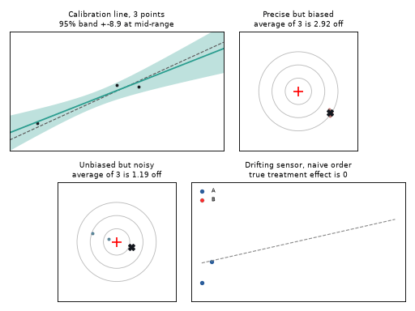
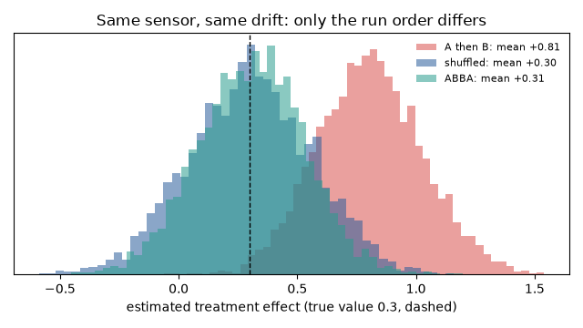
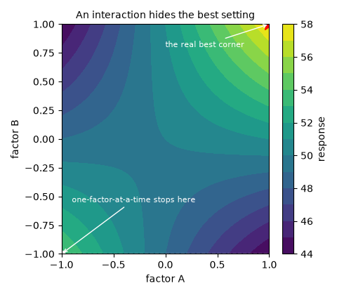

# What you are building toward

Four panels run together. A calibration line tightens as readings arrive, its 95 percent band shrinking. Two target boards show the key lesson of measurement: one sensor is precise but biased, so averaging never moves it to the centre; the other is unbiased but noisy, so averaging does. In the last panel a drifting sensor tests two treatments that do nothing: with all A runs first, the experiment claims a large effect, while shuffling the order gives about zero on average. Your goal over the coming sessions: build that kind of design-and-calibration pipeline yourself, then use it on real hardware.

*Target: a calibration line tightening, bias versus random error on target boards, and a drifting sensor fooling a naive run order*

*Same sensor, same drift: A-then-B, shuffled and ABBA run orders estimate the same treatment very differently*

*An interaction hides the best setting from one-factor-at-a-time testing*

These results come from a private reference build. The code is not published; the roadmap shows the path so you can build your own.

Live links:

- [Math Visual Studio: estimation and regression (Atlas S26)](https://krunalpanchal1995.github.io/studio/#atlas?ch=S26&ex=1)
