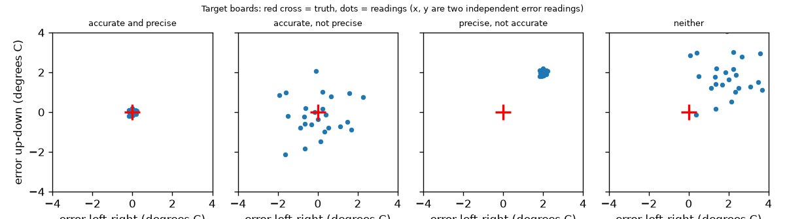
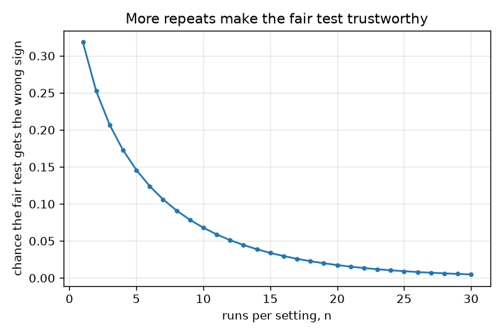

# Session 1: A fair test: one change, repeated, and accurate versus precise

*Level 1 (conceptual interactive model) · about 60 minutes · openexperiment*

> This is a simplified educational model. It is not a validated design tool and must not be used for real structures, electrical installations, vehicles, industrial processes or medical decisions.

**Prerequisites**

- School arithmetic: averages and differences.
- You have read PRIMER.md and run `python start.py 1` once.

**Learning objectives.** After this session you can:

- Explain why a fair test changes only one thing at a time.
- Show, with numbers, how changing two things at once gives a wrong answer.
- Explain why a test must be repeated and use the average of repeats.
- Tell accurate (small bias) from precise (small scatter) using four example thermometers.

## A. Real-world problem
You want to know whether a lid keeps a cup of hot water warmer. You put the lid on a big cup and leave a small cup bare. The covered cup cools less, so the lid works, right? Not necessarily: the big cup would have cooled less anyway. And if you ran the test only once, a lucky or unlucky run could fool you. This session builds a made-up world where the true answer is known, so you can see exactly how unfair and one-off tests go wrong. This is general education about experiments.

## B. Concept and theory
A fair test changes one thing (the lid) and keeps everything else the same (same cup, same water, same time, same thermometer, same way of reading it). Every measurement also has scatter, so we repeat the test and use the mean of the n repeats: the mean's scatter is sd / sqrt(n). The effect of the lid is the mean with the lid minus the mean without. Two words describe a measuring instrument. Accurate means that its readings average close to the truth: its bias (average error) is small. Precise means that repeated readings agree with each other: their scatter (standard deviation) is small. Bias and scatter are independent: all four combinations exist.

| Symbol | Meaning | Unit |
|---|---|---|
| lid effect | true change in cooling drop caused by the lid (-1.0) | degrees C |
| cup effect | true change caused by a big cup (-3.0) | degrees C |
| sd | scatter of one measurement (1.5 for the cooling test) | degrees C |
| n | repeats per setting | no unit |
| bias | average reading minus the truth | degrees C |

**Assumptions**

- The world is made up: true effects are known (lid -1.0, big cup -3.0, base drop 20.0 degrees C).
- Run-to-run scatter is random, bell-shaped and the same for every run.
- The runs are independent of each other.

$$ \text{effect}=\bar y_{\text{lid}}-\bar y_{\text{bare}},\qquad \mathrm{sd}(\bar y)=\frac{\sigma}{\sqrt n} $$

$$ \mathrm{sd}(\bar y_1-\bar y_2)=\sigma\sqrt{\frac{2}{n}} $$

$$ P(\text{wrong sign})=P\!\left(Z>\frac{|\text{effect}|}{\sigma\sqrt{2/n}}\right) $$

$$ \text{typical error}=\sqrt{\text{bias}^2+\left(\frac{\sigma}{\sqrt n}\right)^2} $$

## C. Visual explanation
The first figure shows four thermometers as target boards: the red cross is the truth and each dot is one reading. Accurate and precise gives a tight cluster on the cross; accurate but not precise gives a wide cloud centred on the cross; precise but not accurate gives a tight cluster away from the cross; neither gives a wide cloud away from it. The second figure plots the chance that a fair lid test gets the wrong sign against the number of runs per setting: it falls from 0.32 at one run to below 0.01 at 25 runs.

*Four thermometers as target boards: bias moves the cluster, scatter widens it.*

*The chance that a fair test gets the wrong sign falls as the number of runs per setting grows.*

## D. Interactive simulation
Run the lesson (`python start.py 1`), then open the live app: [Session 1: accurate versus precise](https://krunalpanchal1995.github.io/openexperiment/session-01/) (or `app.html` in this folder). Move the bias, scatter and n sliders. In the readings view, watch how dots spread (scatter), shift (bias) and how the black triangle (their mean) behaves as n grows. In the graph view see that the red bias line never moves down when n grows.

**Challenge.** Get the typical error of the average below 0.5 degrees C.

## E. Worked example and experiment
**Problem.** In the made-up cooling test the lid effect is -1.0 degrees C and the scatter is 1.5 degrees C per run. (a) What does the unfair test (lid on the big cup against a bare small cup) report? (b) With one run per setting in a fair test, what is the chance of the wrong sign?

1. Unfair test, no scatter: (20 - 1 - 3) - 20 = -4 degrees C. It reports -4, but the lid is only -1; the extra -3 is the cup size.
2. Fair test, no scatter: (20 - 1) - 20 = -1 degrees C: the true lid effect.
3. With n = 1 the difference of two runs has scatter 1.5 * sqrt(2) = 2.12 degrees C.
4. A wrong sign needs the difference to exceed 0, that is a shift of 1 / 2.12 = 0.471 standard deviations: the normal tail beyond 0.471 is 0.319.

**Answer.** The unfair test gives -4 (wrong by the cup effect, -3). A one-run fair test says the lid makes things worse in 0.319 of cases, about one time in three. With 9 runs per setting this falls to 0.079.

**Experiment.** Do it for real: two identical mugs, water at the same starting temperature, a lid on one, a thermometer read at the same time (say 10 minutes) and the same way each time. Repeat 5 times, swapping which mug gets the lid. Compare the average difference with a single run. Real water has extra scatter the model lacks (draughts, how the thermometer is held), and the real lid effect depends on the mug; the simulation knows the exact truth, the kitchen does not.

## F. Assessment and design challenge
**Question type A: Conceptual.** A friend says: 'My plant food works: the plants I fed in the sunny window grew taller than the unfed ones on the shelf.' What is wrong with this test, and how would you fix it?

Hint

List everything that differs between the two groups, not just the food.

Step-by-step solution

Two things changed: the food and the position (sunlight). The extra growth may come from the sun. A fair test puts all plants in the same place, changes only the food, uses several plants per group (repeats) and measures them the same way. Like the lid on the big cup, the effect of food cannot be separated from sunlight when both change together.

**Question type B: Numerical.** In the cooling test (lid effect -1.0 degrees C, scatter 1.5 degrees C per run) you use n = 9 runs per setting. What is the scatter of the difference of the two means, and the chance of getting the wrong sign?

Hint

Scatter of the difference = 1.5 * sqrt(2 / n). Then z = 1 / that, and use the normal tail.

Step-by-step solution

Scatter = 1.5 * sqrt(2 / 9) = 0.707 degrees C. z = 1 / 0.707 = 1.414, and the normal tail beyond 1.414 is 0.079. Units: degrees C. Sanity check: it is smaller than the 0.319 for one run, as it should be, because more repeats shrink the scatter.

**Question type C: Graph and simulation interpretation.** In the app graph view, bias is 2.0, sd is 1.0 and you move n from 1 to 100. Describe the black curve and what limits it.

Hint

Compare the blue curve (random part) and the red line (bias).

Step-by-step solution

The black curve (typical total error) starts at sqrt(2^2 + 1^2) = 2.24 at n = 1 and falls, but it flattens at 2.0 (the red line) however large n gets, because averaging shrinks only the random part sd / sqrt(n). To go lower you must remove the bias (calibrate), not take more readings.

**Question type D: Design and optimisation challenge.** Design: you have a thermometer with bias 2.0 degrees C and sd 0.1 degrees C, and another with bias 0 and sd 1.0 degrees C. You can afford at most 25 readings in total. Which do you choose to measure a temperature to within 0.5 degrees C, and what do you do with the first one?

Hint

Compute the typical error sqrt(bias^2 + sd^2/n) for each.

Step-by-step solution

The second one: with 25 readings its typical error is 1.0 / sqrt(25) = 0.2 degrees C (below 0.5). The first one stays at about 2.0 whatever n is. The first could be fixed by calibrating it against a reference (subtracting its bias), after which its scatter 0.1 degrees C makes it the better instrument. The trade-off is the cost and time of the reference measurement. Assumption: the bias is constant.

Score yourself with [RUBRIC.md](../../RUBRIC.md). Print the [activity sheet](activity_sheet.md) to work on paper.

## Common misconceptions
| Common misconception | What is actually true |
|---|---|
| Precise means accurate. | Precise means repeatable; accurate means close to the truth. A thermometer can read 52.0 every time when the truth is 50.0: precise, not accurate. |
| If I repeat the test I will get the same number. | Real measurements scatter. Repeats let you estimate the scatter and average it down by 1 / sqrt(n). |
| Averaging many readings always gets you to the truth. | Averaging removes random error only; a bias stays however many readings you take. |
| A bigger effect in my test means the thing works. | If other things changed too (cup size, position), the difference mixes their effects with the one you want. |

## Glossary
- **fair test**: a comparison in which only one thing is changed
- **repeat**: doing the same measurement again, to see its scatter
- **bias**: the average error of readings; makes an instrument inaccurate
- **scatter (standard deviation)**: typical spread of repeated readings around their mean; small means precise
- **accurate**: readings average close to the true value
- **precise**: repeated readings agree closely with each other

## Finish
1. Do the three coding tasks in [exercises.md](exercises.md).
2. Run `python start.py 1` again after your changes. It ends with the checkpoint; when it prints `PASS`, you are done. (Checkpoint only: `python start.py check 1`.)

Next: [Session 2](../session-02/README.md)
