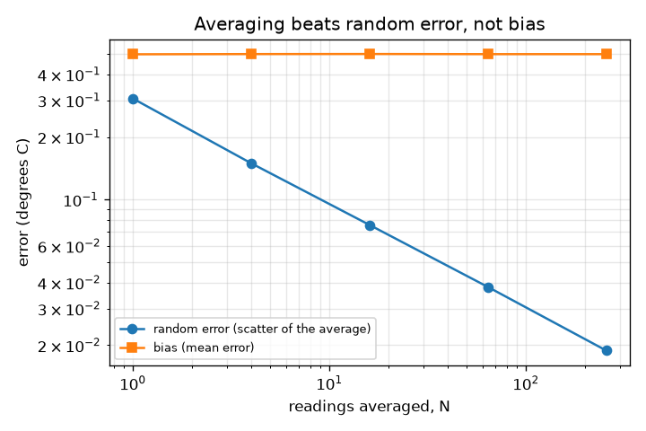
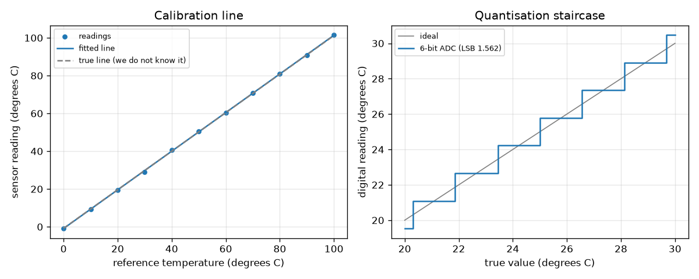

# Session 2: Calibrating a sensor: a line, its uncertainty, and how many readings

*Level 2 (mathematical engineering model) · about 80 minutes · openexperiment*

> This is a simplified educational model. It is not a validated design tool and must not be used for real structures, electrical installations, vehicles, industrial processes or medical decisions.

**Prerequisites**

- Session 1: bias, scatter, averaging.
- The straight line y = m x + c and the idea of a best-fit line.

**Learning objectives.** After this session you can:

- Fit a calibration line by least squares and report slope and intercept with standard errors.
- Invert the calibration line to turn a reading into a true value with an uncertainty.
- Compute the step size and quantisation noise of an N-bit ADC.
- Show by simulation that averaging reduces random error as 1 / sqrt(N) but leaves bias.
- Find how many repeat readings give a target uncertainty at 95 percent.

## A. Real-world problem
A cheap temperature sensor reports 1.02 times the true temperature minus 0.8 degrees, plus noise. You do not know that; you only have its readings and a trusted reference thermometer. How do you turn a reading of 30.4 into a temperature, and how uncertain is the answer? How many readings must you average to know a temperature to within 0.1 degrees? This is general education about measurement, not a procedure for a safety-critical instrument.

## B. Concept and theory
Calibration: measure n known reference values x with the sensor to get readings y, and fit the line y = m x + c by least squares. With Sxx = sum (x - xbar)^2, Sxy = sum (x - xbar)(y - ybar): m = Sxy / Sxx and c = ybar - m xbar. The residual scatter is s = sqrt(sum residual^2 / (n - 2)); the standard errors are SE(m) = s / sqrt(Sxx) and SE(c) = s sqrt(1/n + xbar^2 / Sxx). Inverse prediction: a new reading y0 (the mean of k readings) is turned into x0 = (y0 - c) / m with uncertainty u = (s / |m|) sqrt(1/k + 1/n + (x0 - xbar)^2 / Sxx), smallest in the middle of the calibrated range. Repeatability is the scatter of repeats under the same conditions; reproducibility includes changes of day or set-up, so reproducibility sd = sqrt(repeatability^2 + between-day sd^2). An N-bit ADC over a range lo to hi has LSB = (hi - lo) / 2^N and a rounding error with sd LSB / sqrt(12). Averaging N readings leaves bias unchanged and shrinks the random error to sd / sqrt(N); to reach a 95 percent half-width h we need N >= (1.96 sd / h)^2.

| Symbol | Meaning | Unit |
|---|---|---|
| x | reference (true) temperature | degrees C |
| y | sensor reading | degrees C |
| m, c | calibration slope (no unit) and intercept | degrees C per degree C, degrees C |
| s | residual scatter about the line | degrees C |
| Sxx | sum of squared distances of x from its mean | degrees C squared |
| u(x0) | standard uncertainty of the inverted value | degrees C |
| LSB | ADC step | degrees C |
| N, k | number of readings averaged | no unit |

**Assumptions**

- The sensor is a straight line plus random noise of constant scatter (sd 0.30 degrees C).
- The reference values are exact.
- Gain 1.02, offset -0.80 degrees C and day-to-day shift sd 0.50 degrees C are made up; the 11 reference temperatures are 0, 10, ..., 100 degrees C.
- The standard error formulas use the standard normal point 1.96 for 95 percent (sd treated as known).

$$ m=\frac{S_{xy}}{S_{xx}},\qquad c=\bar y-m\bar x,\qquad s=\sqrt{\frac{\sum (y_i-mx_i-c)^2}{n-2}} $$

$$ \mathrm{SE}(m)=\frac{s}{\sqrt{S_{xx}}},\qquad \mathrm{SE}(c)=s\sqrt{\frac1n+\frac{\bar x^2}{S_{xx}}} $$

$$ x_0=\frac{y_0-c}{m},\qquad u(x_0)=\frac{s}{|m|}\sqrt{\frac1k+\frac1n+\frac{(x_0-\bar x)^2}{S_{xx}}} $$

$$ \mathrm{LSB}=\frac{\text{hi}-\text{lo}}{2^N},\qquad \sigma_q=\frac{\mathrm{LSB}}{\sqrt{12}} $$

$$ \sigma_{\text{repro}}=\sqrt{\sigma_{\text{repeat}}^2+\sigma_{\text{day}}^2},\qquad N\ge\left(\frac{1.96\,\sigma}{h}\right)^2 $$

## C. Visual explanation
The first figure shows the 11 calibration readings, the fitted line and the true line, which lie very close. Next to it is the staircase of a 6-bit ADC: the digital reading jumps in steps of 1.5625 degrees C over a 0 to 100 range. The second figure shows, on log axes, the error of an N-reading average when the sensor has a bias of 0.5 degrees C: the scatter falls as a straight line of slope -1/2 (0.30 / sqrt(N)), but the bias stays flat at 0.50 however many readings are averaged.

*Averaging N readings shrinks the random error as 1 / sqrt(N); the bias of 0.5 degrees C stays.*

*Left: calibration data, fitted line and the true line. Right: the staircase of a 6-bit ADC.*

## D. Interactive simulation
Run the lesson (`python start.py 2`), then open the live app: [Session 2: calibration line](https://krunalpanchal1995.github.io/openexperiment/session-02/) (or `app.html` in this folder). Move the noise slider and the number of calibration points and see how the fitted line wobbles and the slope's standard error changes; then open the repeats view and see how fast the number of readings needed grows with noise.

**Challenge.** Make the expected standard error of the slope below 0.002 while needing at most 10 repeat readings for +-0.1 degrees C at 95 percent.

## E. Worked example and experiment
**Problem.** A calibration with 11 points (0 to 100 degrees C) gave slope 1.02, intercept -0.80 degrees C and s = 0.30 degrees C. The sensor now reads 30.4 degrees C. (a) What is the true temperature and its standard uncertainty? (b) How much better is the average of 4 readings? (c) How many readings are needed to know a mean to +-0.1 degrees C at 95 percent when the scatter is 0.30?

1. x0 = (30.4 - (-0.80)) / 1.02 = 31.2 / 1.02 = 30.59 degrees C.
2. Sxx = 11000, xbar = 50, so (x0 - xbar)^2 / Sxx = (30.59 - 50)^2 / 11000 = 0.0343.
3. k = 1: u = (0.30 / 1.02) sqrt(1 + 1/11 + 0.0343) = 0.2941 * 1.061 = 0.312 degrees C.
4. k = 4: u = 0.2941 * sqrt(0.25 + 0.0909 + 0.0343) = 0.2941 * 0.6126 = 0.180 degrees C: better, but not 4 times better, because the calibration line itself stays uncertain.
5. Readings needed: N >= (1.96 * 0.30 / 0.1)^2 = 5.88^2 = 34.57, rounded up to 35.

**Answer.** True temperature 30.59 degrees C with u = 0.31 degrees C (one reading) or 0.18 degrees C (mean of 4); 35 readings are needed for +-0.1 degrees C at 95 percent (34 readings reach only 0.948, 35 reach 0.951).

**Experiment.** Calibrate a real thermometer or thermistor against a better thermometer in iced water, room-temperature water and hot tap water (three or more points), then fit the line with `np.polyfit` and invert it. Real sensors are not perfectly straight, the reference has its own uncertainty, and the water is not uniform in temperature; the simulation has none of these, so its quoted uncertainty is too optimistic for the real thing.

## F. Assessment and design challenge
**Question type A: Conceptual.** Why is the uncertainty of the inverted temperature smallest in the middle of the calibrated range and larger near the ends? Why can you not reduce it to zero by averaging the new readings?

Hint

Look at the term (x0 - xbar)^2 / Sxx and at the 1/n term in the formula.

Step-by-step solution

The fitted line is pinned best near the centre of the data (the mean point xbar, ybar); its tilt error acts like a lever, so errors grow with the distance (x0 - xbar). Averaging k new readings removes only the 1/k term; the calibration terms 1/n and (x0 - xbar)^2 / Sxx stay, since they come from the one calibration you made. To lower them, add calibration points.

**Question type B: Numerical.** A sensor has scatter sd = 1.0 degrees C. How many readings must be averaged to know the mean to +-0.2 degrees C at 95 percent, and how many for +-0.1?

Hint

N >= (1.96 sd / h)^2 and round up.

Step-by-step solution

For h = 0.2: (1.96 / 0.2)^2 = 96.04, so N = 97. For h = 0.1: (1.96 / 0.1)^2 = 384.2, so N = 385. Halving the target needs 4 times the readings. Units: sd and h in degrees C, N has no unit. This assumes the bias is zero or already removed.

**Question type C: Graph and simulation interpretation.** In the average-versus-bias figure the scatter line falls with slope -1/2 on log axes while the bias line is flat. What does each tell you, and which could you reduce by taking more readings?

Hint

The scatter follows sd / sqrt(N).

Step-by-step solution

A slope of -1/2 on log-log axes means error proportional to N^(-1/2): random error, reduced by averaging (0.30 for N = 1, 0.075 for N = 16 and 0.019 for N = 256). The flat line at 0.5 degrees C is the bias: averaging never reduces it. Only calibration (finding and subtracting it) can.

**Question type D: Design and optimisation challenge.** Design: a 10-bit ADC over 0 to 100 degrees C is available. Its sensor noise sd is 0.30 degrees C. Is the quantisation noise a problem compared with the sensor noise? Would an 8-bit ADC be acceptable? Justify with numbers.

Hint

Compute LSB / sqrt(12) for 10 and 8 bits and compare with 0.30. Combine independent errors as the square root of the sum of squares.

Step-by-step solution

10 bits: LSB = 100 / 1024 = 0.0977 degrees C, quantisation sd = 0.0282, tiny against 0.30 (total sqrt(0.30^2 + 0.0282^2) = 0.301). 8 bits: LSB = 0.3906, sd = 0.1128 (total sqrt(0.09 + 0.0127) = 0.320, about 7 percent worse). So 8 bits is acceptable if a 7 percent increase in scatter is tolerable and the saving in cost matters; 10 bits is practically free of quantisation error. The sensor noise also helps: noise about one LSB wide lets averaging remove the rounding error.

Score yourself with [RUBRIC.md](../../RUBRIC.md). Print the [activity sheet](activity_sheet.md) to work on paper.

## Common misconceptions
| Common misconception | What is actually true |
|---|---|
| A fitted line with small scatter must be accurate. | Small residuals say the data lie near a line, not that the line is right: a reference with a bias, or a curved sensor, gives a neat but wrong line. |
| The calibration line has no uncertainty of its own. | Slope and intercept have standard errors; they appear in the inverse-prediction uncertainty. |
| More bits always means a better sensor. | Bits set the step (resolution), not the accuracy: a 12-bit ADC on a biased sensor is still biased. |
| Averaging more readings fixes everything. | It shrinks only random error (as 1 / sqrt(N)); bias is untouched, and rounding error from an ADC does not average away when the signal does not move across steps. |
| Repeatability and reproducibility are the same. | Repeatability: same conditions, same day. Reproducibility includes changes such as another day or set-up, so it is larger (0.58 against 0.30 degrees C here). |

## Glossary
- **calibration**: comparing an instrument with trusted references and fitting a correction curve
- **least squares**: choosing the line that makes the sum of squared residuals smallest
- **residual**: a reading minus the fitted line's value at that point
- **standard error**: the standard deviation of a fitted quantity such as the slope
- **inverse prediction**: using the calibration line backwards to estimate the true value from a reading
- **repeatability**: scatter of repeats under the same conditions
- **reproducibility**: scatter when conditions change (another day, operator, set-up)
- **resolution**: the smallest step the instrument can show
- **LSB**: least significant bit: one ADC step, (hi - lo) / 2^N
- **quantisation noise**: rounding error from the ADC steps, LSB / sqrt(12)

## Finish
1. Do the three coding tasks in [exercises.md](exercises.md).
2. Run `python start.py 2` again after your changes. It ends with the checkpoint; when it prints `PASS`, you are done. (Checkpoint only: `python start.py check 2`.)

Next: [Session 3](../session-03/README.md)
