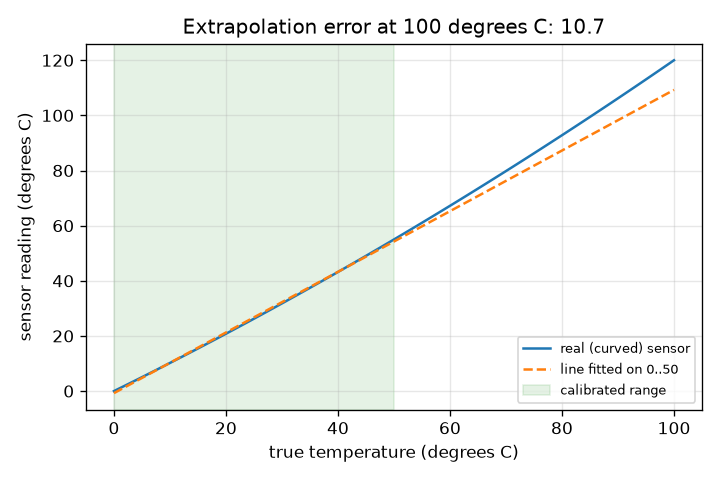
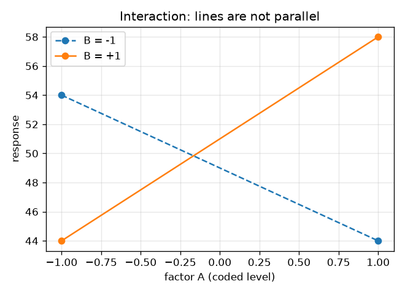
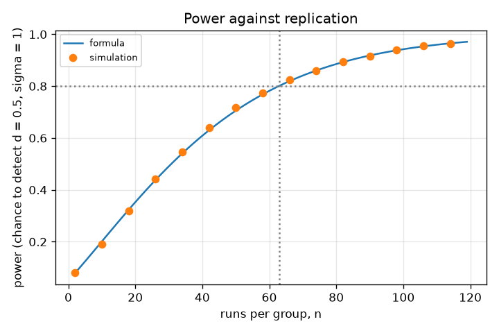
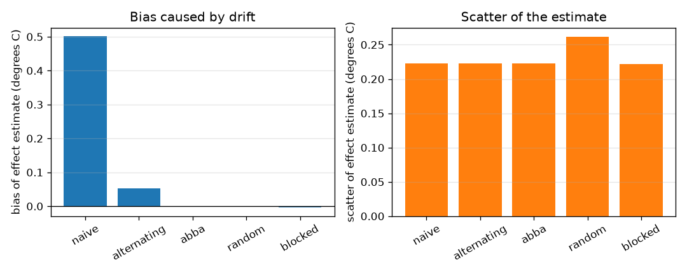

# Session 3: Designing the experiment: order, replicates, factors and drift

*Level 3 (simulation and validation) · about 90 minutes · openexperiment*

> This is a simplified educational model. It is not a validated design tool and must not be used for real structures, electrical installations, vehicles, industrial processes or medical decisions.

**Prerequisites**

- Session 1: fair test, repeats.
- Session 2: calibration line, uncertainty, averaging.

**Learning objectives.** After this session you can:

- Show by simulation how a drifting sensor biases a naive run order, and compare random, blocked and ABBA orders.
- Compute the number of replicates for a given effect size, scatter and power, and verify it by Monte Carlo.
- Estimate main effects and an interaction from a 2x2 factorial design and see how one-factor-at-a-time fails.
- Choose a re-calibration interval and recognise the failure of extrapolating a nonlinear sensor.
- Run a two-factor calibration (temperature and supply voltage) and report effects, calibration and residual uncertainty.

## A. Real-world problem
You must compare two treatments with a sensor that slowly drifts upward while you work. If you run all of treatment A first and all of B afterwards, B looks better even when it does nothing. How should the 20 runs be ordered? How many runs do you need to see a small effect? And what if two factors only help when changed together? This session tests each design on a simulated world where the true answer is known. It is general education, not a template for a regulated or safety-critical test.

## B. Concept and theory
Randomisation, balance and blocking protect against nuisance factors such as drift. With a straight-line drift of r per run, the effect estimate (mean B minus mean A) is biased by r times (mean run number of B minus mean run number of A): 10 r when all A runs come first, 0 for an ABBA pattern. Under complete random order the bias is zero on average, but the drift adds scatter: for 20 runs with 10 per treatment the added variance is 7 r^2. Pairing runs and randomising within each pair (randomised blocks) keeps almost none of it. Replication: for a two-sided z-test at 5 percent significance with power 80 percent, n = 2 (z_a + z_b)^2 sigma^2 / d^2 runs per group detect a difference d (z_a = 1.96, z_b = 0.8416). Factorial design: a 2x2 design runs all four corners of two factors at coded levels -1 and +1; main effect A = mean(A high) - mean(A low), interaction AB = half the difference of A's effect at B high and B low. One-factor-at-a-time changes one factor from a start and keeps the better; with an interaction it can stop at a worse setting. Calibration drift: if the offset error after calibration has standard uncertainty u and then drifts at rate r, keep 1.96 u + r t within the tolerance. A line fitted in one range must not be used outside it if the sensor curves.

| Symbol | Meaning | Unit |
|---|---|---|
| r | drift per run (0.05) or per day (0.02) | degrees C per run or per day |
| d | true difference between group means | same unit as the response |
| sigma | scatter of one run | same unit as the response |
| n | runs per group | no unit |
| z_a, z_b | normal points for significance (1.96) and power (0.8416) | no unit |
| A, B | coded factor levels | -1 or +1 |
| u | uncertainty of the offset just after calibration | degrees C |
| tol | allowed error | degrees C |

**Assumptions**

- Drift is a straight line in the run number; real drift can be curved or jumpy.
- Scatter is random, bell-shaped, the same for every run and independent between runs.
- The power formula uses a z-test with known sigma; with an estimated sigma a t-test needs slightly more runs.
- The systems (response = 50 + A + B + 6 A B, the curved sensor, the voltage-dependent sensor) are made up for teaching.
- Recalibration uses a one-sided 97.5 percent starting error and a known constant drift rate.

$$ \text{bias}=r\,(\bar t_B-\bar t_A),\qquad \text{(all A first: } 10r\text{; ABBA: } 0) $$

$$ n=\frac{2\,(z_{\alpha}+z_{\beta})^2\sigma^2}{d^2},\qquad \text{power}=\Phi\!\left(\frac{d}{\sigma\sqrt{2/n}}-z_\alpha\right) $$

$$ E_A=\tfrac12\,(y_{+-}+y_{++}-y_{--}-y_{-+}),\qquad E_{AB}=\tfrac12\,(y_{--}+y_{++}-y_{+-}-y_{-+}) $$

$$ t_{\max}=\left\lfloor\frac{\text{tol}-1.96\,u}{r}\right\rfloor,\qquad y=b_0+b_1T+b_2\,\Delta V+b_3\,T\,\Delta V $$

## C. Visual explanation
The first figure compares five run orders for the 20-run experiment: all-A-first has a bias of 0.50 degrees C, alternating 0.05, and ABBA, random and blocked about 0; full randomisation has the largest scatter (0.26) while ABBA and randomised blocks stay near the noise-only 0.22. The second figure plots power against runs per group for a difference of 0.5 and scatter of 1.0: the curve crosses 0.80 at 63 runs, and the simulated dots sit on it. The third shows two non-parallel lines (an interaction) for the made-up system. The fourth shows the line fitted on 0 to 50 degrees C departing from the curved sensor, with an error of 10.75 degrees C at 100 degrees C.

*A line fitted on 0 to 50 degrees C fails outside the calibrated range of a curved sensor.*

*An interaction: the effect of A changes sign with B.*

*Power against runs per group for d = 0.5, sigma = 1: formula (line) and simulation (dots).*

*Bias (left) and scatter (right) of the effect estimate for five run orders under drift.*

## D. Interactive simulation
Run the lesson (`python start.py 3`), then open the live app: [Session 3: run order and replication](https://krunalpanchal1995.github.io/openexperiment/session-03/) (or `app.html` in this folder). Set the drift, the noise and the runs per group. In the order view watch the drift line lift the B points in the naive order; in the power view see where the curve crosses the 80 percent line. The readout compares naive and random orders.

**Challenge.** Find a lab with a drift small enough that the naive order is biased by less than 0.25 degrees C, and enough runs per group for 80 percent power to detect an effect of 0.3 degrees C.

## E. Worked example and experiment
**Problem.** Treatment B truly raises the response by 0.30 degrees C. The sensor drifts by 0.05 degrees C per run and one run has scatter 0.50. Twenty runs: 10 of A and 10 of B. (a) What bias does the all-A-then-all-B order have? (b) How many runs per group would detect a difference d = 0.5 with sigma = 1.0 at 5 percent significance and 80 percent power? (c) In the 2x2 system response = 50 + A + B + 6AB, what are the effects, and where does one-factor-at-a-time stop?

1. (a) Mean run number of A is 4.5, of B is 14.5: bias = 0.05 * (14.5 - 4.5) = 0.50 degrees C, bigger than the true effect 0.30.
2. Noise alone gives scatter 0.50 * sqrt(2 / 10) = 0.2236; complete randomisation adds drift scatter 0.05 * sqrt(7) = 0.132, total sqrt(0.2236^2 + 0.132^2) = 0.260.
3. (b) n = 2 * (1.96 + 0.8416)^2 * 1.0^2 / 0.5^2 = 2 * 7.849 / 0.25 = 62.79, rounded up to 63 runs per group.
4. (c) The four runs (-,-), (+,-), (-,+), (+,+) give 54, 44, 44, 58. A = ((44 + 58) - (54 + 44)) / 2 = 2, B = 2, AB = ((54 + 58) - (44 + 44)) / 2 = 12.
5. One-factor-at-a-time starts at (-,-) = 54: raising A gives 44 (worse), raising B gives 44 (worse), so it stops at 54; the best is (+,+) = 58.

**Answer.** (a) A bias of 0.50 degrees C. (b) 63 runs per group (power 0.801; 62 give 0.795). (c) Effects 2, 2 and 12; one-factor-at-a-time stops at 54 and misses the best setting 58.

**Experiment.** Do the run-order comparison with a kettle and two mugs: warm the kitchen slowly or let a cooling cup act as the drift. Run 10 trials of 'with stirring' and 10 'without' in naive and shuffled orders and compare. Real drift is not a straight line and real scatter is not constant; the model gets the direction (naive orders mislead, shuffling or ABBA protects) but exact numbers will differ.

## Real-world application and mini-project: Calibrate a sensor across temperature and supply voltage
A made-up sensor reads 0.98 T + 0.5 + (V - 5)(0.8 + 0.004 T) plus a drift of 0.01 degrees C per run and noise with sd 0.30 degrees C, where T is the true temperature (degrees C) and V the supply voltage (volts). Use `run_experiment`, `two_factor_effects`, `fit_two_factor` and `estimate_T` from Session 3. Run the 2x2 design (T = 20 and 80 degrees C, V = 4.5 and 5.5 V, 5 runs per corner in randomised blocks), report the effects, fit the calibration, and compare the temperature error of one new reading at 50 degrees C and 5.4 V when the voltage is in the model and when it is ignored.

**Deliverable:** A script that prints the effect of T, the effect of V and the T x V interaction with the standard error 0.30 / sqrt(5), prints the fitted coefficients and residual sd, and prints the temperature error with and without the voltage in the calibration, then saves a figure of the four corner means.

**Success looks like:** The effects are close to 58.8 (T), 1.0 (V) and 0.12 (T x V) within three standard errors; the residual standard uncertainty of one reading at 50 degrees C and 5.4 V is about 0.29 degrees C with the voltage modelled, while ignoring the voltage gives an error of about 0.74 degrees C.

## F. Assessment and design challenge
**Question type A: Conceptual.** Why does randomising the run order protect an experiment against drift you did not know about, while ABBA only protects against straight-line drift? What does randomisation cost?

Hint

Think about what each design assumes about the drift, and look at the scatter figure.

Step-by-step solution

Random order breaks the link between treatment and time whatever the drift looks like, so the bias is zero on average for any drift shape. ABBA cancels exactly a drift that is a straight line, but a curved drift is not cancelled exactly. The cost of full randomisation is extra scatter (0.26 against 0.22 degrees C here) because the drift is no longer cancelled in each run. Randomised blocks (random order within each pair) give both: protection and low scatter.

**Question type B: Numerical.** How many runs per group are needed to detect a difference d = 0.25 with sigma = 1.0 at 5 percent significance and 80 percent power? Compare with d = 0.5 (63 runs).

Hint

n = 2 (1.96 + 0.8416)^2 sigma^2 / d^2.

Step-by-step solution

n = 2 * 7.849 * 1.0 / 0.0625 = 251.2, rounded up to 252. Halving the difference to detect multiplies n by 4 (63 to 252). Units: sigma and d in the same unit, n has no unit. Sanity check: 4 times 62.79 is 251.2.

**Question type C: Graph and simulation interpretation.** In the interaction figure the two lines are not parallel. What does this say about the effect of factor A, and why does one-factor-at-a-time fail here?

Hint

Read the effect of A (the change along the line) at B = -1 and at B = +1.

Step-by-step solution

At B = -1 raising A lowers the response (54 to 44); at B = +1 it raises it (44 to 58). The effect of A depends on B: that is an interaction (AB = 12). One-factor-at-a-time varies A only at B = -1, sees a decrease and concludes the wrong thing; it never visits (+,+), the best corner.

**Question type D: Design and optimisation challenge.** Design: after calibration the offset uncertainty is 0.10 degrees C, the drift is 0.02 degrees C per day and the allowed error is 0.50 degrees C. How often must you recalibrate? What happens after 20 days? What if the tolerance were 0.10?

Hint

Solve 1.96 * 0.10 + 0.02 t <= 0.50 for t. The chance of being above +0.50 after t days is the normal tail beyond (0.50 - 0.02 t) / 0.10.

Step-by-step solution

t <= (0.50 - 0.196) / 0.02 = 15.2, so recalibrate every 15 days: the chance of being above +0.50 is then 0.0228. After 20 days that chance is 0.159. With a tolerance of 0.10 even a fresh calibration (1.96 * 0.10 = 0.196) exceeds it, so no interval works: the calibration uncertainty itself must be reduced (better reference, more points). Trade-off: a shorter interval costs more time and reference use.

Score yourself with [RUBRIC.md](../../RUBRIC.md). Print the [activity sheet](activity_sheet.md) to work on paper.

## Common misconceptions
| Common misconception | What is actually true |
|---|---|
| Changing one factor at a time is always the safest design. | It cannot see interactions: in the made-up system it stops at 54 while the best is 58. |
| Randomising makes the result more precise. | Full randomisation removes bias but adds scatter (0.26 against 0.22 degrees C); blocking recovers the precision. |
| If my test is not significant, there is no effect. | With too few runs the power is low: 16 runs per group detect d = 0.5, sigma = 1 only 29 percent of the time. |
| A calibration line is valid anywhere. | Only inside the range you calibrated, and only if the sensor is straight; outside it, the error grew to 10.75 degrees C for the curved sensor. |
| A calibration stays valid forever. | Offsets drift; a schedule combines the calibration uncertainty, the drift rate and the tolerance. |

## Glossary
- **randomisation**: choosing the run order (or assignment) by chance
- **blocking**: grouping runs (here in pairs) so that comparisons are made within a group
- **replication**: repeating runs of the same treatment
- **power**: the chance a test detects a real difference
- **factorial design**: an experiment that runs all combinations of the factor levels
- **main effect**: the average change of the response when one factor goes from low to high
- **interaction**: when the effect of one factor depends on the level of another
- **confounding**: mixing two causes so that their effects cannot be separated
- **drift**: slow change of an instrument or condition with time
- **extrapolation**: using a fitted curve outside the range of the data

## Finish
1. Do the three coding tasks in [exercises.md](exercises.md).
2. Run `python start.py 3` again after your changes. It ends with the checkpoint; when it prints `PASS`, you are done. (Checkpoint only: `python start.py check 3`.)

Next: the [roadmap](../../promo/roadmap.md). Session 4 is yours to build.
